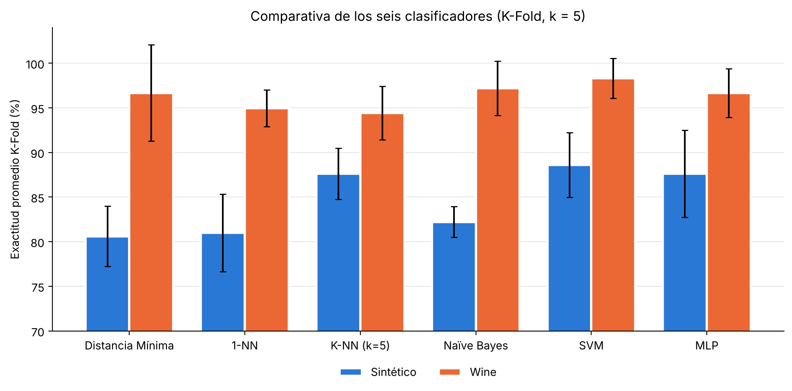
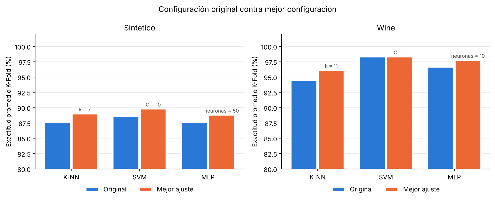

# Práctica 3: Machine Learning

**Alumno:** Diego Raymundo Hernández Alonso · **Boleta:** 2022361124 · **Grupo:** 6CV2<br>
**Unidad de aprendizaje:** Inteligencia Artificial · **Profesor:** Andrés García Floriano<br>
Escuela Superior de Cómputo, Instituto Politécnico Nacional

En esta práctica comparo seis clasificadores sobre dos conjuntos de datos. Tres de ellos los programé desde cero solo con Python y NumPy, y los otros tres los tomé de scikit-learn. Cada modelo lo evalué con dos métodos de validación: Hold-Out 70/30 y Validación Cruzada K-Fold con k = 5.

## Contenido del repositorio

| Archivo | Descripción |
|---|---|
| `Practica3_MachineLearning.ipynb` | Notebook con todo el código y los resultados ya ejecutados |
| `Reporte_Practica3_HernandezAlonso.pdf` | Reporte de resultados |
| `figuras/` | Gráficas generadas por el notebook |
| `requirements.txt` | Bibliotecas necesarias |

## Conjuntos de datos

- **Sintético con ruido estructurado:** 500 muestras, 3 clases y 6 rasgos (4 informativos y 2 redundantes), generado con `make_classification`. El 10% de las etiquetas se cambió al azar para meter ruido.
- **Wine (benchmark):** 178 vinos de 3 cultivos con 13 rasgos químicos numéricos. Viene incluido en scikit-learn.

En los dos casos los datos se escalan con `StandardScaler`, ajustado solo con los datos de entrenamiento de cada partición.

## Clasificadores

| Programados desde cero | De scikit-learn |
|---|---|
| Distancia Mínima (centroides) | Naïve Bayes (`GaussianNB`) |
| 1-NN | SVM (`SVC`) |
| K-NN (k = 5, distancia euclidiana) | Perceptrón Multicapa (`MLPClassifier`, `max_iter = 3000`) |

Para comprobar que los clasificadores hechos a mano funcionan bien, comparé sus predicciones contra las de `NearestCentroid` y `KNeighborsClassifier`: coinciden en el 100% de las muestras.

## Resultados principales (exactitud)

| Modelo | Sintético Hold-Out | Sintético K-Fold | Wine Hold-Out | Wine K-Fold |
|---|---|---|---|---|
| Distancia Mínima | 80.00% | 80.6% ± 3.38% | 98.15% | 96.67% ± 5.39% |
| 1-NN | 77.33% | 81.0% ± 4.34% | 98.15% | 94.95% ± 2.07% |
| K-NN (k = 5) | 86.67% | 87.6% ± 2.87% | 98.15% | 94.41% ± 3.01% |
| Naïve Bayes | 81.33% | 82.2% ± 1.72% | 98.15% | 97.21% ± 3.04% |
| SVM | 88.67% | 88.6% ± 3.61% | 98.15% | 98.32% ± 2.23% |
| MLP | 84.67% | 87.6% ± 4.88% | 100.00% | 96.65% ± 2.72% |



También probé otros valores de parámetros en K-NN (k = 3, 7, 11), SVM (C = 0.1, 10, 100) y MLP (10 y 50 neuronas). Las mejores configuraciones subieron la exactitud de K-Fold entre 1.1 y 1.7 puntos.



El análisis completo, las respuestas a las preguntas de la práctica y la complejidad temporal de cada clasificador están en el notebook y en el reporte PDF.

## Cómo ejecutarlo

```bash
pip install -r requirements.txt
jupyter notebook Practica3_MachineLearning.ipynb
```

Después se ejecutan todas las celdas en orden. Como se usa una semilla fija (`random_state = 74`), los resultados salen siempre iguales.
